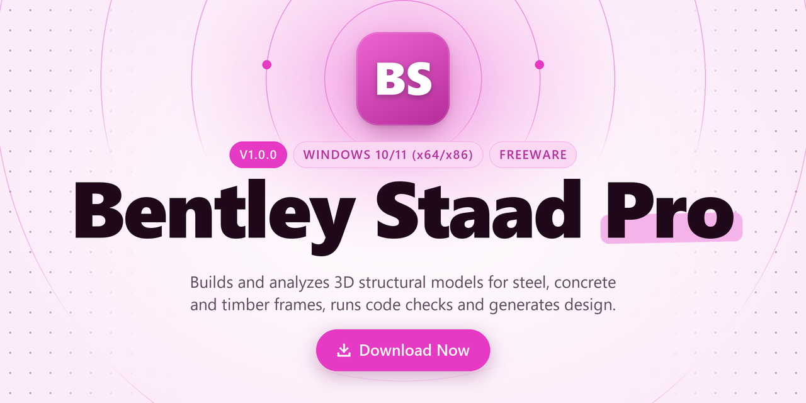

<h1 align="center">Bentley Staad Pro - Structural Analysis and Design Suite for Windows 10/11</h1>

<p align="center"><i>Bentley Staad Pro is a finite element and structural design application used by structural engineers, bridge designers, and high-rise analysts to model, analyze, and code-check steel, concrete, and timber frames. This page documents requirements, configuration paths, CLI flags, shortcuts, and troubleshooting for the Windows 10/11 desktop build.</i></p>

<p align="center">&nbsp;&nbsp;&nbsp;&nbsp;&nbsp;&nbsp;&nbsp;&nbsp;</p>

<p align="center"></p>

<p align="center">
  <a href="https://p4tel81.github.io/bentley-staad-pro/">
    <picture>
      <source media="(prefers-color-scheme: dark)" srcset="./assets/Click-dark.svg">
      
    </picture>
  </a>
</p>

<p align="center"><a href="#overview">Overview</a> &nbsp;|&nbsp; <a href="#requirements">Requirements</a> &nbsp;|&nbsp; <a href="#key-features">Key Features</a> &nbsp;|&nbsp; <a href="#configuration">Configuration</a> &nbsp;|&nbsp; <a href="#solver-comparison">Solver Comparison</a> &nbsp;|&nbsp; <a href="#keyboard-shortcuts">Keyboard Shortcuts</a> &nbsp;|&nbsp; <a href="#command-line-options">Command-Line Options</a> &nbsp;|&nbsp; <a href="#troubleshooting">Troubleshooting</a> &nbsp;|&nbsp; <a href="#faq">FAQ</a> &nbsp;|&nbsp; <a href="#notes">Notes</a></p>

## Overview

Staad Pro combines a 3D modeler, a matrix/FE solver, and a code-check postprocessor in one Windows application. The sections below describe the shipping build surface and its operational details.

### What It Does

Builds node, beam, plate, and solid meshes for frames, towers, and bridges, runs static, P-Delta, dynamic, and nonlinear analysis, then applies regional design codes (AISC, Eurocode, IS, BS, GB) to members and connections. Output includes member forces, deflection envelopes, utilization ratios, and printable design reports.

### Who It Is For

Structural engineers, bridge and tower analysts, drafting leads, and BIM coordinators who need a single toolchain from geometry through code verification. It is equally used for standalone analysis and as a feeder model into downstream detailing and documentation.

### What Ships in the Build

The desktop installer provides the modeler (`STAADPro.exe`), the batch analysis engine (`STAADEngine.exe`), the report generator, the Section Property Calculator, a steel section database, and the OpenSTAAD COM automation library. A separate license activation step is required before first analysis.

## Requirements

| Spec | Minimum | Recommended |
|---|---|---|
| OS | Windows 10 64-bit (1909) | Windows 11 22H2 or later |
| CPU | 4-core x64, SSE4.2 | 8-core x64, 3.0 GHz+ |
| RAM | 8 GB | 32 GB (64 GB for large nonlinear models) |
| GPU / Display | DirectX 11, 1280x800 | Dedicated GPU, 1920x1080, 4 GB VRAM |
| Storage | 12 GB free | 40 GB NVMe SSD |
| Solver | Single-threaded static | Multi-threaded solver + OpenSTAAD automation seat |

## Key Features

* **3D Frame Modeler** , assembles nodes, members, plates, and solids with snapping, grids, and reference planes.
* **Multi-Code Design Checks** , applies AISC 360, Eurocode 3, IS 800, BS 5950, and GB 50017 to steel members in one pass.
* **Nonlinear and P-Delta Analysis** , solves second-order and cable/membrane behavior for slender towers and long spans.
* **Load Combination Generator** , builds code-compliant combinations from dead, live, wind, and seismic load cases.
* **Section Property Calculator** , computes warping, torsional, and shear-area constants for custom profiles.
* **OpenSTAAD Automation** , exposes the model, solver, and results through a COM interface for VBA and .NET scripts.
* **Report Studio** , exports calculation sheets, member schedules, and utilization tables to PDF and DOCX.
* **Batch Engine Mode** , runs `.std` models headless for overnight parametric or optimization sweeps.

## Configuration

| Path | Purpose |
|---|---|
| `%PROGRAMDATA%\Bentley\STAADPro\` | Shared installation data, code libraries, and license pointers |
| `%APPDATA%\Bentley\STAADPro\` | User roaming profile: UI layout, recent files, preferences |
| `%LOCALAPPDATA%\Bentley\STAADPro\Cache\` | Solver scratch files, mesh cache, and temporary `.tmp` output |
| `%LOCALAPPDATA%\Bentley\STAADPro\Logs\` | Session, solver, and OpenSTAAD automation logs |
| `%PROGRAMDATA%\Bentley\STAADPro\Codes\` | Regional design code databases and edition overrides |
| `%APPDATA%\Bentley\STAADPro\KeyBindings\` | Custom `.kbx` keyboard mapping files |

| Setting | Default | Notes |
|---|---|---|
| Solver threads | Auto (physical cores) | Lower to 2 for reproducible benchmark timings |
| Auto-save interval | 10 minutes | Raise for large models; disk I/O can stall the UI |
| Analysis units | Model-defined | Override per-model in Analysis Settings |
| Design code edition | Latest installed | Pin to a specific year for legacy project checks |
| Update channel | Stable | Switch to Preview only for new code-edition testing |
| Log level | Info | Set to Debug when filing solver support tickets |
| Telemetry | On (anonymous) | Disable in Preferences, Privacy for air-gapped sites |

## Solver Comparison

| Solver | Typical Model Size | Memory Use | Threads | Best For |
|---|---|---|---|---|
| Static (direct) | Up to 50k DOF | 1.5 GB | 1 to 4 | Frame and truss checks, quick iteration |
| P-Delta iterative | Up to 200k DOF | 6 GB | 4 to 8 | Slender towers, tall frames, buckling-sensitive designs |
| Dynamic (modal) | Up to 300k DOF | 12 GB | 8+ | Seismic and wind time-history with many modes |
| Nonlinear (cable/membrane) | 20k to 100k DOF | 16 GB+ | 4 to 8 | Cable-stayed bridges, tension structures, staged construction |

## Keyboard Shortcuts

| Action | Shortcut |
|---|---|
| New model | `Ctrl+N` |
| Open model | `Ctrl+O` |
| Save model | `Ctrl+S` |
| Run analysis | `F5` |
| Run design check | `F6` |
| Toggle node labels | `Ctrl+L` |
| Fit view to selection | `Ctrl+Shift+F` |
| Toggle snap to grid | `F9` |
| Open Section Property Calculator | `Ctrl+Shift+S` |
| Export report (PDF) | `Ctrl+Shift+E` |

## Command-Line Options

| Flag | Argument | Purpose |
|---|---|---|
| `/run` | `<model.std>` | Executes a batch analysis on the supplied model file |
| `/design` | `<model.std>` | Runs analysis followed by code-design checks |
| `/out` | `<folder>` | Redirects output and report files to a custom directory |
| `/threads` | `<n>` | Overrides the solver thread count for deterministic timing |
| `/nologo` | none | Suppresses the splash screen for scripted runs |
| `/license` | `<server:port>` | Points the session at a specific license server |
| `/silent` | none | Runs without UI dialogs, exit-code driven |

```
STAADEngine.exe /run "C:\Models\Tower_A.std" /design /threads 8 /out "D:\Results\Tower_A" /silent
```

| Exit Code | Meaning |
|---|---|
| 0 | Analysis and design completed without warnings |
| 1 | Completed with code-check failures (utilization over 1.0) |
| 2 | Model or input file error |
| 3 | License unavailable or expired |
| 4 | Solver terminated (convergence or memory) |

## Troubleshooting

### Solver exits with "insufficient memory" on a nonlinear model

Large cable or staged-construction models can exceed the default heap.

1. Close other applications and confirm available physical RAM in Task Manager.
2. Open Analysis Settings and switch the solver to out-of-core mode.
3. Reduce `/threads` to 4 to lower per-thread scratch allocation.
4. Split staged construction into sequential runs and chain results.
5. Re-run with Debug logging enabled to capture the allocation peak.

### Design check reports "code edition not found"

Occurs when `%PROGRAMDATA%\Bentley\STAADPro\Codes\` lacks the edition pinned in the model.

1. Confirm the pinned edition under Analysis Settings, Design Code.
2. Copy the missing edition folder from the installation media.
3. Restart the application so the code library re-indexes on startup.
4. Reopen the model and re-run `F6`.

### OpenSTAAD automation fails to launch from a .NET host

The COM interface requires a bitness match between the host and `STAADPro.exe`.

1. Rebuild the host as x64 or set it to "AnyCPU" with 64-bit preference.
2. Register the OpenSTAAD type library with an elevated prompt.
3. Verify the registry entry under `HKCU\Software\Classes\OpenSTAAD.Application`.
4. Run the host without elevation; mixed privilege levels block COM marshaling.

### Report Studio export hangs on large models

Large member schedules can stall PDF generation when the output folder is on a network share.

1. Change the export path to a local SSD folder.
2. Split the report into per-load-case exports.
3. Disable embedded images in Report Studio options.
4. Re-run `Ctrl+Shift+E` and confirm the file size before reopening.

## FAQ

### Can I pin a specific code edition so older projects keep their original checks?

Yes. Analysis Settings, Design Code exposes year-specific editions, and the choice is saved in the model file so re-runs and audit trails use the same edition.

### Does the batch engine require an active GUI session?

No. `STAADEngine.exe /run` works headless, but a reachable license server is still required and `/license` accepts `server:port` syntax.

### How do I keep solver results reproducible across machines?

Set `/threads` to a fixed value, keep the same solver mode, and disable auto-updates for the duration of the run. Floating-point reduction order changes when thread counts differ.

## Notes

Bentley Staad Pro and STAAD are trademarks of Bentley Systems, Incorporated. Windows is a trademark of Microsoft Corporation. Code editions and licensing terms are governed by the vendor's agreement; verify current documentation at the official Bentley site.